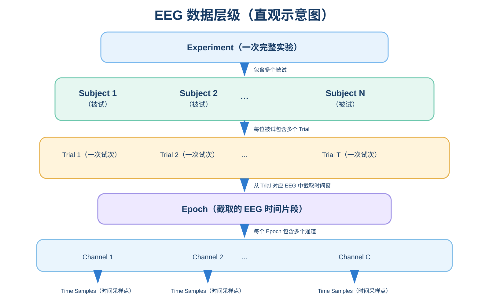
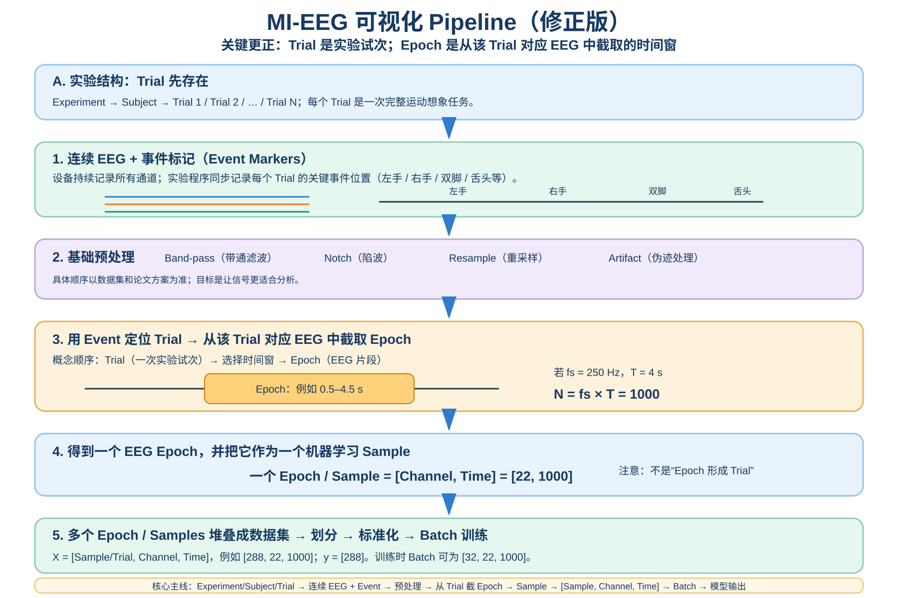

# Beginner Prerequisites｜零基础科研与 MI-EEG 前置知识

> 这份文件只放“后面读论文、跑 Baseline、做实验之前必须真正理解的基础概念”。不追求一次学完，而是随着项目推进逐步补齐。

## 知识分层

```text
零基础层
↓
MI 基础层
↓
算法层
↓
论文研究层
```

当前优先级：**先搞懂数据，再搞懂训练，再进入模型。**

---

## 1. EEG 数据层级



最重要的概念关系：

```text
Experiment
└── Subject
    └── Trial：一次完整实验试次
        └── Epoch：从该 Trial 对应 EEG 中截取的时间片段
            └── Channel
                └── Time Samples
```

注意：在很多 MI 代码中，已经切好的一个 Epoch 会被直接称为一个 `trial` 或一个 `sample`。因此读论文/代码时必须根据数据张量含义判断，而不能只看变量名。

---

## 2. 原始 MI-EEG 怎么变成模型输入

### 当前使用的修正版 Pipeline



核心主线：

```text
实验中的 Trial 已经存在
↓
连续 EEG + Event Markers
↓
基础预处理
↓
用 Event 定位 Trial
↓
从 Trial 对应 EEG 中截取 Epoch
↓
一个 Epoch 作为一个机器学习 Sample
↓
堆叠为 X = [Sample/Trial, Channel, Time]
↓
划分 Train / Validation / Test
↓
标准化 / 归一化
↓
Batch
↓
Model
↓
Prediction
```

例如：

```text
采样率 fs = 250 Hz
截取时间 T = 4 s
时间采样点 N = fs × T = 1000
通道数 C = 22
```

所以一个 Epoch / Sample：

```text
[Channel, Time] = [22, 1000]
```

如果有 288 个样本：

```text
X = [288, 22, 1000]
y = [288]
```

---

## 3. Trial / Epoch / Sample：必须分清

| 术语 | 当前项目中的理解 |
|---|---|
| Trial | 实验设计层面的一次完整试次，例如一次“左手运动想象”任务 |
| Epoch | 从 Trial 对应连续 EEG 中截取的一个时间窗口 |
| Sample | 送给机器学习模型的一条训练实例；在典型 MI 分类中通常就是一个 Epoch |
| Time Sample | EEG 时间轴上的一个采样点，和“机器学习 Sample”不是一回事 |

典型 MI 分类里经常近似为：

```text
1 Trial → 1 Epoch → 1 machine-learning Sample
```

但这是“一一对应”，不是三个概念完全相同。

---

## 4. 标准化与归一化：当前先掌握到这里

### Standardization（标准化）

常见形式：

```text
z = (x - μ) / σ
```

直观理解：把数据重新缩放到“以 0 附近为中心、尺度比较统一”的范围，让训练更稳定。

### Normalization（归一化）

通常指把数值按某种规则缩放到统一范围，例如 `[0, 1]`。具体定义要看论文或代码，不能看到 `normalize` 就默认一定是 Min-Max。

### 最重要的科研原则：防止数据泄漏

如果均值 `μ`、标准差 `σ` 是从数据计算得到的：

```text
Train → 计算 μ_train, σ_train
Train → 使用 μ_train, σ_train
Validation/Test → 也只能使用 μ_train, σ_train
```

不能先把 Train + Test 混在一起计算统计量。

> 后续需要继续学习：标准化到底按“全训练集 / 每个通道 / 每个 Trial”哪个维度计算，以及不同 Baseline 的实际实现。

---

## 5. Dataset / Sample / Feature / Label / Batch / Epoch / Loss

| 术语 | 最小理解 |
|---|---|
| Dataset | 全部样本及其标签的集合 |
| Sample | 一条模型输入实例；典型 MI 中常为一个 EEG Epoch |
| Feature | 模型用于分类的信息表示；可以是人工特征，也可以由神经网络自动学习 |
| Label | 样本真实类别，例如左手/右手/双脚/舌头 |
| Train Set | 用来更新模型参数的数据 |
| Validation Set | 用来调参、选模型、早停等的数据 |
| Test Set | 最后评估泛化能力的数据，不能参与调参 |
| Batch | 一次送入模型的一组 Samples |
| Epoch（训练语境） | 模型把整个训练集完整学习一遍；注意它和 EEG 的 Epoch 是同名不同义 |
| Model | 从输入数据学习映射并输出预测的算法/网络 |
| Loss | 衡量模型预测与真实标签差距的训练目标 |

### 一个非常容易混淆的词：Epoch

EEG 语境：

```text
EEG Epoch = 从连续 EEG 中截出的时间片段
```

深度学习训练语境：

```text
Training Epoch = 模型完整遍历一次训练集
```

两者必须靠上下文区分。

---

## 6. 训练阶段到底输入什么、输出什么

假设：

```text
X_train = [2304, 22, 1000]
Batch Size = 32
```

DataLoader 每次给模型：

```text
[Batch, Channel, Time] = [32, 22, 1000]
```

四分类模型最终可能输出：

```text
[32, 4]
```

即 32 个 Sample，每个 Sample 对应 4 个类别的分数/概率。

模型训练要完成的本质是：

```text
EEG Sample
↓
Model
↓
Prediction
↓
与 Label 比较
↓
Loss
↓
更新模型参数
```

---

## 7. 当前学习顺序

### 必须完成

1. EEG 数据层级。
2. 连续 EEG + Event → Trial/Epoch → `[Sample, Channel, Time]`。
3. Dataset / Sample / Label / Batch 的关系。
4. Train / Validation / Test 为什么必须分开。
5. 标准化 / 归一化的基本目的和防泄漏原则。
6. 模型训练时“输入什么、输出什么、Loss 在干什么”。

### 应该完成

1. BCI Competition IV 2a 的实际数据结构。
2. LOSO / subject-independent 划分。
3. MI 常见预处理：Band-pass、重采样、Epoching。
4. Accuracy、Kappa 等评价指标。

### 有余力再做

1. 复杂伪迹去除。
2. 更高级标准化策略。
3. 频域/时频表示。
4. Transformer、注意力等模型内部细节。

---

## 8. 历史图：为什么保留旧版

旧版流程图保留在：

`assets/archive/mi_eeg_pipeline_v1_deprecated.svg`

它的问题是把流程表达成了“Epoch → 形成 Trial”，容易让人误以为 Trial 是后处理得到的。修正后的概念是：

```text
Trial 是实验试次
↓
Event 帮助我们定位它
↓
从 Trial 对应 EEG 中截取 Epoch
↓
Epoch 进入模型时通常作为 Sample
```

以后以**修正版 Pipeline**为准。
